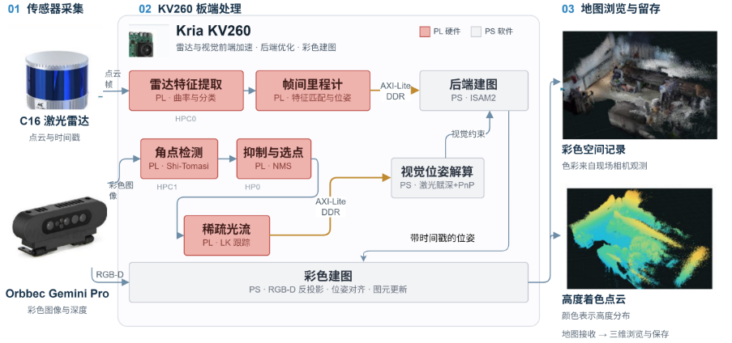

# 留境 · KV260 雷达视觉融合三维重建

本包按“传感器采集—KV260 前后端处理—地图浏览与留存”组织，包含 final3 硬件工程、雷达与视觉定位、200 万点 RGB-D 融合和电脑端三维展示源码。



## 数据流与源码

| 环节 | 输入与输出 | 源码位置 |
|---|---|---|
| C16 采集 | 带时间戳点云 `/point_cloud_raw` | `sensors/lidar/` |
| 雷达特征提取 | 点云 → 特征点及分类 | `hardware/final3/hls_src/fe_p0/`、`localization/final3/scripts/pynq_feature_extraction.py` |
| 帧间里程计 | 特征对应 → `/odom_init/laser_odom` | `localization/final3/src/laserOdometry.cpp`、雷达硬件工程中的 registration 源码 |
| 相机采集与分发 | Orbbec RGB-D → 融合队列、共享彩色图像话题 | `mapping/liujing/native_fusion_overflow/runtime.cpp` |
| 角点检测、抑制与选点、光流 | 灰度图像 → 前后帧像素对应 | `hardware/final3/hls_src/`、`vision/lvi_board/pl_match.py` |
| 视觉位姿解算 | 像素对应 + 雷达赋深 → `/vo_pnp/abs` | `integration/visual_node.py`、`vision/lvi_board/vo_core.py` |
| 后端建图 | 雷达里程计 + 视觉约束 → `/mapping/odometry` | `localization/final3/src/map_optimization.cpp` |
| 彩色建图 | RGB-D + 带时间戳的位姿 → 200 万点融合地图 | `mapping/liujing/native_fusion_overflow/` |
| 地图浏览与留存 | LJCD 增量 → 彩色地图、高度点云、PLY | `pc/liujing/demo_fusion/` |

## 统一入口

`integration/run_pipeline.py` 管理位流加载、雷达采集、特征处理、里程计、视觉位姿、后端优化和地图融合进程。启动脚本为 `integration/run_final.sh`。

相机由融合程序中的 Orbbec SDK 采集线程统一打开。同步 RGB-D 帧进入地图融合队列，其中彩色帧通过 `/liujing/camera/color/compressed` 分发给视觉节点。视觉节点关联最近的雷达帧，完成灰度图去畸变、PL 特征匹配、雷达投影赋深和 PnP，随后发布 `/vo_pnp/abs`。后端将视觉相对运动加入位姿图，融合端接收连续里程计和优化位姿进行 RGB-D 地图更新。

final3 位流由统一入口加载一次。雷达和视觉节点使用 `PL_DOWNLOAD=0` 复用同一 Overlay。地图融合采用 CPU 面元关联，容量为 2,000,000；电脑端保留稳定点 ID 并应用增量更新。

## 构建与启动

板端依赖 Ubuntu 22.04、ROS 2 Humble、PYNQ、OpenCV、Eigen、PCL、Ceres、GTSAM、Orbbec SDK。硬件工程入口为 `hardware/final3/merge_final3.tcl`，HLS 源码和 IP 同目录提供。

```bash
bash integration/build.sh
sudo bash integration/run_final.sh --seconds 600 --out ./output/demo
```

相机参数默认读取 `mapping/liujing/configs/live_candidate_20261026.json`，也可通过 `--calibration` 指定文件。参数包括内参、畸变、相机/机体外参及时间关系。

电脑端进入 `pc/`，开启端口转发和页面服务：

```powershell
ssh -N -L 127.0.0.1:18090:127.0.0.1:8090 -L 127.0.0.1:18092:127.0.0.1:8092 ubuntu@192.168.1.102
python liujing/demo_fusion/server.py --out ./output/demo
```

浏览器打开 `http://127.0.0.1:8097`。彩色地图显示 RGB，高度点云使用 Z 值渐变色；鼠标旋转和平移，WASD 移动视角，F 显示全景，PLY 导出保留原始 RGB。


## 双系统融合位流（2026-11 新增）

`hardware/fusion/` 为单静态位流（fusion.bit，7,797,810 B，sha256 885bda03e5ef57cf 前缀），同片含**压缩雷达特征核（60.5k→28k LUT）+ 彩色面元渲染核 + Shi-Tomasi + NMS**，构建入口 `hardware/fusion/fusion_bd.tcl`。正确性与速度均已实测：

- 雷达核与 HLS C 仿真**逐点相同**（flat 33 / sharp 83 / lesssharp 142，双向差集 0），见 `hardware/fusion/csim/`。
- 渲染核（640×480）与 CPU 参考输出**逐位相同**（depth maxdiff = 0）。
- 速度（street1 同序列同窗口）：雷达特征提取 28.6 → 7.26 ms（4.0×）；渲染 CPU 侧 196.3 → 64 ms（−67%，渲染转 PL 并行）；整链吞吐 0.34 → 0.55 Hz（+62%）。
- 资源：CLB 98.05%，WNS +1.135 ns @100 MHz，报告见 `hardware/fusion/reports/`。

## 目录

- `hardware/final3/`：集成硬件源码、IP、位流、HWH 和实现报告。
- `localization/final3/`：统一流程使用的定位工程与视觉因子后端。
- `vision/`：视觉 PL 主机控制、PnP 与视觉节点源码。
- `mapping/liujing/`：地图融合、传感器接口和会话工具。
- `integration/`：顶层启动编排、视觉节点和数据接口；`integration/bench/` 为整机 CPU 版 / PL 版 A/B 基准脚本。
- `hardware/fusion/`：双系统融合位流（压缩雷达核 + 彩色渲染核 + ST/NMS 单 bit）、BD 构建脚本与 csim 等价性验证。

- `sensors/`：雷达驱动。
- `pc/`：浏览器服务和三维展示。
- `localization/live_c16/` 及 `mapping/liujing/tools/fusion_overflow.sh`：独立 C16 实车入口。

接口字段见 `integration/接口说明.md`；源码来源和文件校验值见 `SOURCE_INDEX.json`。
